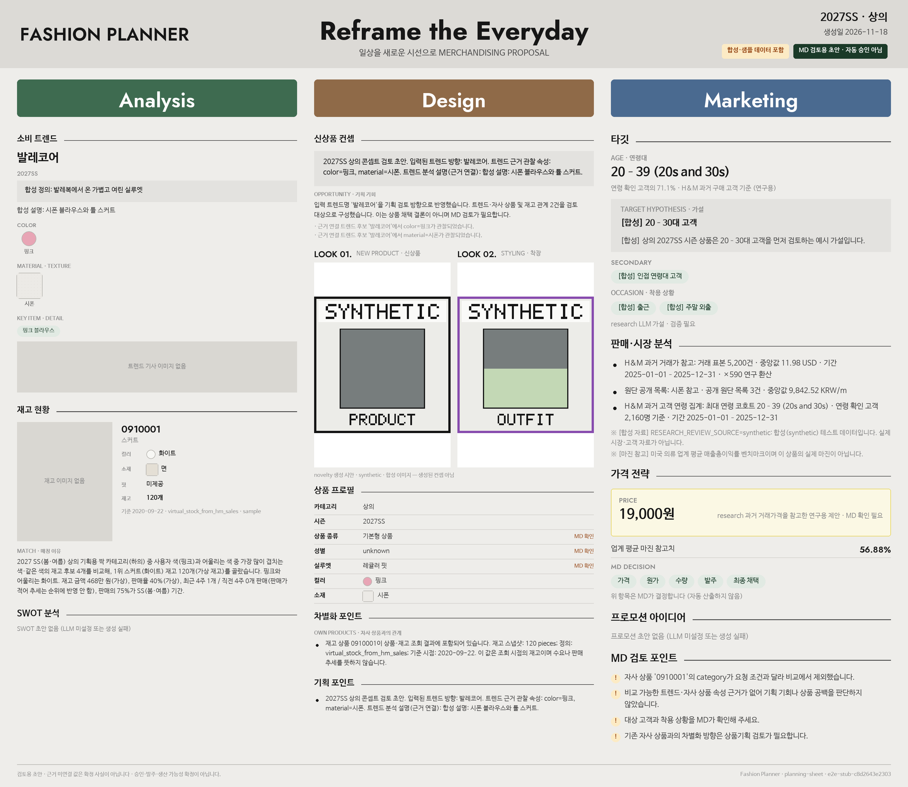
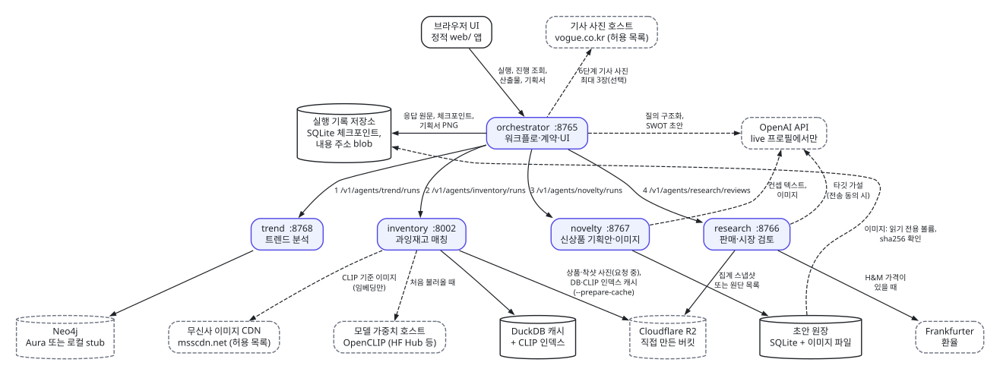
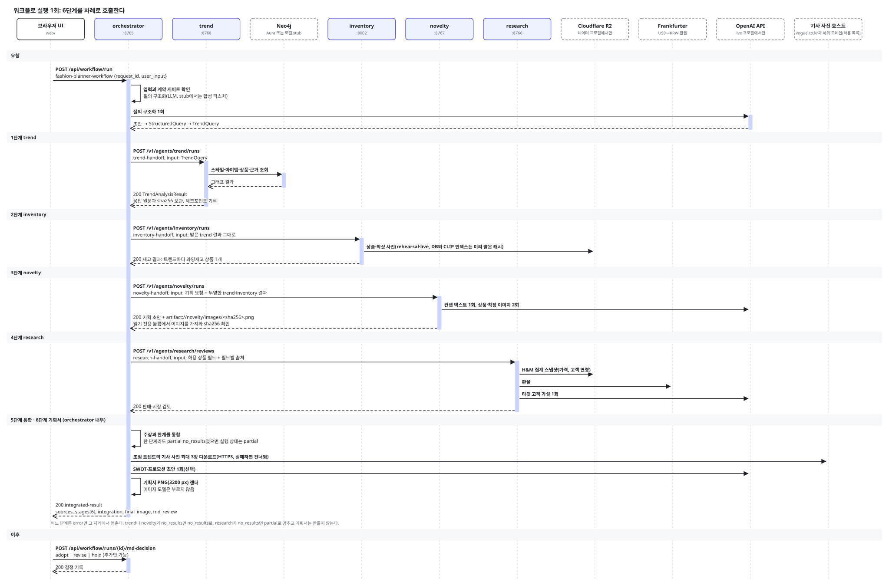
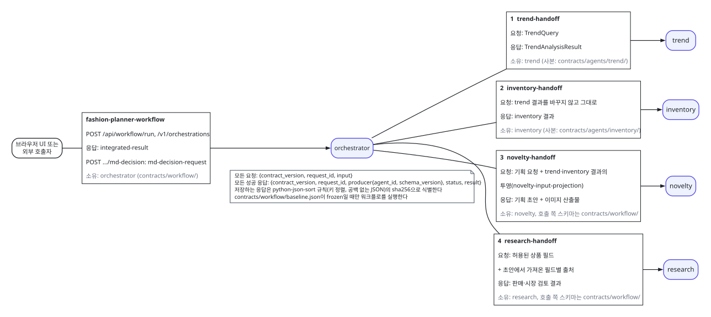

# fashion-planner-orchestrator

**Fashion Planner의 조정자와 웹 UI.** MD의 상품 기획 요청 하나를 받아 네 서비스를 차례로 부르고, 응답을 계약으로
검증해 원문 그대로 보관한 뒤, 트렌드 근거가 붙은 신상품 기획안과 한 장짜리 기획서 PNG를 만든다.

> 이 레포는 **fashion-planner** 5개 레포 중 하나입니다. 전체 구조와 실행 방법은 [fashion-planner-orchestrator](https://github.com/KG-RAG-02/fashion-planner-orchestrator)에서 시작하세요.

| 레포 | 역할 |
|---|---|
| **[fashion-planner-orchestrator](https://github.com/KG-RAG-02/fashion-planner-orchestrator)** | **기획 질의 구조화, 6단계 워크플로 실행, 웹 UI, 기획서 PNG, Docker 통합 배포** |
| [fashion-planner-trend](https://github.com/KG-RAG-02/fashion-planner-trend) | Vogue Korea 기사에서 트렌드 추출, Neo4j 지식 그래프, 유사 상품 검색 |
| [fashion-planner-inventory](https://github.com/KG-RAG-02/fashion-planner-inventory) | 트렌드에 맞는 과잉재고 상품 매칭(규칙 + CLIP) |
| [fashion-planner-novelty](https://github.com/KG-RAG-02/fashion-planner-novelty) | 트렌드 기반 신상품(novelty) 기획안과 제품·착장 이미지 생성 |
| [fashion-planner-research](https://github.com/KG-RAG-02/fashion-planner-research) | 기획안의 판매·시장 조사(가격, 원단 원가, 고객 연령, 타깃) |

novelty는 *신상품*, research는 *판매·시장 검토*를 뜻한다. 각 서비스는 혼자 실행하고 테스트할 수 있고, 이 레포가 다섯을
묶어 실행한다.



*stub 프로필(합성 데이터만)로 만든 기획서. 이미지는 novelty의 합성 이미지이고 기사 사진은 없다.*

## 개요

MD가 "2027년 봄 발레코어에서 유행하는 핑크색 상의를 기획하고 싶어"처럼 입력하면 orchestrator는 다음을 차례로 한다.

1. 문장을 구조화된 질의로 바꾸고, 첫 품목·첫 시즌을 trend가 받는 TrendQuery로 만든다.
2. **trend**에 맞는 트렌드 스타일과 근거(기사 인용)를 묻는다.
3. **inventory**에 트렌드마다 함께 제안할 과잉재고 상품을 묻는다.
4. **novelty**에 신상품 기획 초안과 상품·착장 이미지를 요청한다.
5. **research**에 초안의 상품을 판매·시장 자료로 검토해 달라고 요청한다.
6. 결과를 통합해 기획서 PNG를 그리고, MD의 결정(채택·수정·보류)을 기록한다.

서비스끼리는 서로 부르지 않는다. 모든 요청과 응답을 JSON Schema와 의미 검사로 확인하고, 응답 원문과 SHA-256을 실행
기록에 남긴다. 그래서 기획서의 값이 어느 응답에서 왔는지 끝까지 따라갈 수 있다. 서비스가 낸 `no_results`와 빈 값은
0이나 성공으로 바꾸지 않는다.

## 아키텍처

<picture>
  <source media="(prefers-color-scheme: dark)" srcset="docs/diagrams/system-dark.svg">
  
</picture>

<picture>
  <source media="(prefers-color-scheme: dark)" srcset="docs/diagrams/sequence-workflow-dark.svg">
  
</picture>

- 구조 설명(멈춤 규칙, 저장과 재실행, 기획서, 네트워크 경계): [docs/architecture.md](docs/architecture.md)
- 그림의 상자와 화살표마다 코드 근거: [docs/diagrams/CLAIMS.md](docs/diagrams/CLAIMS.md)
- 설계 결정: [docs/decisions/](docs/decisions/)

## 기능

- **계약으로 검증하는 6단계 워크플로.** 단계 순서가 고정되어 있고, 모든 호출과 응답을 JSON Schema(Draft 2020-12)와 결합
  검사(요청 ID, 해시, 근거 연결, 투영, 출처)로 확인한다.
- **계약 게이트.** 다섯 레포의 계약을 동결한 기준선(`contracts/workflow/baseline.json`)이 있을 때만 실행한다.
- **추적 가능한 실행 기록.** 응답 원문은 SHA-256 내용 주소 blob, 단계 상태는 SQLite 체크포인트로 남긴다. 같은 요청은
  저장된 결과로 답하고, 결과를 모르는 유료 호출은 다시 보내지 않는다.
- **질의 구조화.** LLM은 원문을 쪼개고 표준 값을 제안만 하고, 값 확정(trend 어휘·별칭 사전)과 조립은 코드가 한다.
- **기획서 PNG.** 초점 트렌드와 기사 사진, 매칭된 재고, 신상품 콘셉트와 이미지, 판매·시장 값, 선택적인 SWOT 초안을 담은
  가로 3200 px 포스터. 실행 기록만으로 결정적으로 그리고 이미지 모델은 부르지 않는다.
- **네트워크 경계.** orchestrator만 127.0.0.1에 공개하고, 서비스 호출은 공용 bearer 토큰과 HTTPS(또는 명시한 내부 호스트의
  평문 HTTP)만 쓴다.

## 빠른 시작

### 전체 시스템 (Docker, 오프라인 stub)

stub 프로필은 합성 데이터로 다섯 서비스를 모두 띄운다. 계정과 API 키가 필요 없고, 이미지를 빌드한 뒤에는 네트워크도
필요 없다. Docker Engine 26.0 이상과 Compose v2, Python 3.11 이상, 디스크 여유 약 10 GB가 필요하다([deploy/README.md](deploy/README.md#준비)).

```bash
mkdir fashion-planner && cd fashion-planner
for svc in orchestrator trend inventory novelty research; do
  git clone https://github.com/KG-RAG-02/fashion-planner-$svc.git
done
cd fashion-planner-orchestrator
deploy/bin/fashion-planner init-env          # ~/.config/fashion-planner/fashion-planner.env 생성(권한 600)
deploy/bin/fashion-planner preflight stub
deploy/bin/fashion-planner build
deploy/bin/fashion-planner stub              # 스택을 띄우고 종단 간 검사 실행
```

<http://127.0.0.1:18765>를 열어 위의 예시 질의를 넣는다. 멈출 때는 `deploy/bin/fashion-planner down stub`(볼륨은 남는다).
실제 데이터를 쓰는 `rehearsal`과 OpenAI를 부르는 `live`는 [deploy/README.md](deploy/README.md)를 본다.

### 이 레포만 (Docker 없이)

```bash
python3 -m venv .venv && . .venv/bin/activate
pip install -e '.[workflow,query]'
ORCHESTRATOR_QUERY_STRUCTURING_MODE=synthetic_fixture python app.py   # http://127.0.0.1:8765
```

UI, 질의 구조화(합성 초안), 저장된 실행 조회는 혼자 동작한다. 워크플로를 실행하려면 네 서비스의 URL과 토큰이 필요하다
([configs/README.md](configs/README.md), 예시 [configs/agent-http.env.example](configs/agent-http.env.example)).

## 설정

설정은 환경변수로 하고, 빈 값은 설정하지 않은 것으로 본다. 자주 쓰는 것만 적었다. 전체 목록은
[configs/README.md](configs/README.md), 배포 도구 설정은 [deploy/README.md](deploy/README.md)에 있다.

| 변수 | 기본값 | 뜻 |
|---|---|---|
| `ORCHESTRATOR_TREND_URL`, `ORCHESTRATOR_INVENTORY_URL`, `ORCHESTRATOR_NOVELTY_URL`, `ORCHESTRATOR_RESEARCH_URL` | 없음 | 네 서비스의 기본 URL |
| `FASHION_PLANNER_SERVICE_TOKEN` | 없음 | 다섯 서비스가 함께 쓰는 bearer 토큰 |
| `ORCHESTRATOR_WORKFLOW_STORE_DIR` | `.local/workflow` | 실행 기록 저장소 |
| `ORCHESTRATOR_QUERY_STRUCTURING_MODE` | LLM | `synthetic_fixture`면 오프라인 합성 초안 |
| `LLM_MODEL`, `LLM_API_KEY` | 없음 | 질의 구조화와 SWOT 초안의 LLM |
| `ORCHESTRATOR_WORKFLOW_IMAGES_ENABLED` | 꺼짐 | `1`이면 6단계 기획서를 그린다 |
| `ORCHESTRATOR_TREND_PHOTOS_ENABLED` | 켜짐 | `0`이면 기획서에 넣을 기사 사진을 받지 않는다([고지](#고지)) |

## 데이터

이 레포에는 실제 데이터가 없다. 테스트와 stub은 합성 데이터만 쓰고, `data/query-structuring-eval/`의 질의 구조화 평가
세트도 합성이며 라벨은 사람이 검증하지 않았다. 각 서비스가 쓰는 데이터, 기사 사진의 권리, research의 동의 설정은
[docs/data.md](docs/data.md)에 있다.

## API와 계약

| 메서드와 경로 | 용도 |
|---|---|
| `POST /api/workflow/run`, `POST /v1/orchestrations` | 워크플로 실행(`fashion-planner-workflow`) |
| `GET /api/workflow/runs`, `GET /api/workflow/runs/{request_id}` | 실행 목록, 저장된 통합 결과 |
| `GET`·`POST /api/workflow/runs/{request_id}/md-decision` | MD 결정 조회·추가 |
| `GET /api/workflow/runs/{request_id}/planning-sheet.png` | 끝난 실행의 기획서 |
| `GET /api/workflow/artifacts/{sha256}` | 저장된 산출물(이미지) |
| `POST /v1/input-images` | 요청 이미지 업로드 |
| `POST /v1/orchestrations/image-retries` | 6단계만 다시 그리기(기본은 꺼짐) |
| `GET /api/system/status`, `GET /api/health` | 서비스 연결·계약 상태, 생존 확인 |

orchestrator가 부르는 경로는 `/v1/agents/{trend,inventory,novelty}/runs`, `/v1/agents/research/reviews`이고, 전송 이름은
`trend-handoff`, `inventory-handoff`, `novelty-handoff`, `research-handoff`다. 이 레포는 호출 쪽 스키마
([contracts/workflow/](contracts/workflow/))와 각 서비스 계약의 사본([contracts/agents/](contracts/agents/))을 둔다. 규칙,
해시, 오류 코드는 [docs/contracts.md](docs/contracts.md)에, 질의 구조화 계약은 [docs/query-structuring.md](docs/query-structuring.md)에 있다.

<picture>
  <source media="(prefers-color-scheme: dark)" srcset="docs/diagrams/contracts-dark.svg">
  
</picture>

## 프로젝트 구조

```text
src/fashion_planner_orchestrator/
  server.py                 HTTP 진입점, 정적 UI, 인바운드 신뢰 검사
  workflow_http.py          워크플로 API, 설정, 서비스 어댑터
  workflow.py               6단계 실행, 체크포인트, 통합
  workflow_contract.py      계약 검증과 게이트
  workflow_store.py         실행 기록(SQLite, 내용 주소 blob)
  upstream_projection.py    novelty에 보내는 투영
  planning_sheet.py         기획서 렌더러 (trend_photos.py, swot.py)
  query/                    질의 구조화
contracts/                  호출 쪽 스키마, 기준선, 서비스 계약 사본
prompts/                    질의 구조화·SWOT 프롬프트
configs/                    비밀이 아닌 설정
data/                       질의 구조화 평가 데이터(합성)
web/                        UI(빌드 없는 ES 모듈)
deploy/                     Docker Compose 프로필, 실행기, 종단 간 검사
scripts/                    계약 동결·사본 생성, 생성물 갱신, 평가, 다이어그램
tools/                      계약 기준 검증기, UI 이미지 생성기
docs/                       구조, 계약, 데이터, 트러블슈팅, 결정 기록, 다이어그램
```

## 테스트

모든 테스트는 오프라인이다. 외부 서비스, 유료 API, 다른 레포가 없어도 돈다.

```bash
pip install -e '.[workflow,query]'
PYTHONPATH=src python -m unittest discover -s tests
node --test web/tests/model.test.mjs
python scripts/freeze_workflow_contract.py --check
```

기획서 PNG 테스트에는 한글 글꼴(`fonts-nanum` 또는 macOS의 Apple SD Gothic Neo)이 필요하고, 없으면 이유를 남기고
건너뛴다. CI(`.github/workflows/ci.yml`)는 생성물이 원본과 같은지도 확인한다. 다이어그램은 `sh scripts/render_diagrams.sh`로
다시 그린다(Graphviz, librsvg, Pretendard 글꼴 필요).

## 문제 해결과 교훈

다섯 서비스를 연결하며 겪은 문제를 [docs/troubleshooting.md](docs/troubleshooting.md)에 적었다. 본문 크기 한도가 "서비스
사용 불가"로 보였던 일, 호출하는 쪽과 받는 쪽의 타임아웃 순서, 읽기 전용 컨테이너에서 드러난 숨은 쓰기, 기획서가 두
트렌드를 섞어 보여 준 일 같은 것이다.

## 한계

- trend에는 질의의 첫 품목과 첫 시즌만 보낸다. 나머지는 구조화된 질의에 남기고 경고로 알린다.
- 서비스 호출은 순차적이고 자동 재시도가 없다. live 실행 한 번에 몇 분이 걸릴 수 있다.
- 실행 기록과 서버는 한 호스트용이다(SQLite, 표준 라이브러리 `http.server`). 인터넷에 직접 공개하는 용도가 아니다.
- stub 결과는 시스템이 동작한다는 것만 보여 준다. 기획안의 품질이나 모델 성능을 뜻하지 않는다.
- rehearsal과 live에는 직접 준비한 계정과 데이터가 필요하다.
- 기획서 렌더 테스트용 fixture(`tools/workflow_contract/fixtures/integrated-*.json`)의 research 결과는 예전 응답 형식이다.

## 감사의 말

- 글꼴: Bodoni Moda, Jost(둘 다 SIL Open Font License 1.1, 라틴 문자만 남긴 사본, `web/fonts/*/OFL.txt`).
  다이어그램 글꼴 Pretendard(SIL OFL 1.1)는 레포에 넣지 않았다.
- UI 배경 이미지는 `tools/ui-assets/silk.py`로 만든 것이다.
- 코드와 문서 일부는 AI 도우미(Claude)의 도움을 받아 작성했고, 해당 커밋에 `Co-Authored-By` 줄이 있다.
- 함께 만든 사람들: [AUTHORS.md](AUTHORS.md). 기여 방법: [CONTRIBUTING.md](CONTRIBUTING.md), 보안 신고: [SECURITY.md](SECURITY.md).

## 고지

- 이 프로젝트는 학습·교육 목적의 비상업 프로젝트입니다. Condé Nast, Vogue Korea(두산매거진), 무신사, H&M과 관련이 없으며 이들의 승인이나 후원을 받지 않았습니다. 'Vogue'는 해당 권리자의 상표입니다.
- 이 레포에는 제3자 데이터(기사 원문, 이미지, 상품·거래 데이터)가 들어 있지 않습니다. 데이터를 직접 받아 쓰는 경우 각 출처의 이용약관을 따라야 합니다. 자세한 내용은 `docs/data.md`를 보세요.
- 기본 설정에서 6단계는 초점 트렌드의 기사 사진을 허용 목록의 호스트(기본 `vogue.co.kr`)에서 최대 3장 받아 로컬 실행
  기록에 저장하고 기획서에 넣으며, UI의 트렌드 카드도 같은 호스트의 사진을 브라우저에서 직접 불러옵니다. 이 사진의
  권리는 권리자에게 있습니다. 사진이 들어간 기획서 PNG와 실행 기록은 공유하거나 공개하지 마세요.
  `ORCHESTRATOR_TREND_PHOTOS_ENABLED=0`으로 사진 받기를 끌 수 있습니다.

## 라이선스

코드는 [MIT 라이선스](LICENSE)로 배포합니다. MIT 라이선스는 이 레포의 코드에만 적용되며, 외부 데이터셋과 그 파생물에는 적용되지 않습니다.
