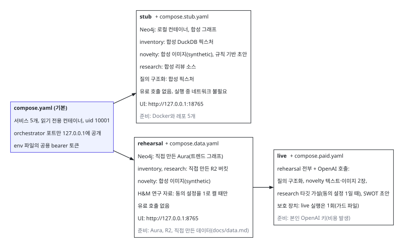

# 배포 (Docker Compose)

다섯 서비스를 한 호스트에서 Docker Compose로 띄운다. 다섯 레포가 같은 폴더에 나란히 있어야 한다(빌드 경로가
`../../fashion-planner-<서비스>`다). 결정 배경은 [docs/decisions/0006](../docs/decisions/0006-single-host-compose-profiles.md)에 있다.

<picture>
  <source media="(prefers-color-scheme: dark)" srcset="../docs/diagrams/deploy-profiles-dark.svg">
  
</picture>

## 프로필

| 프로필 | 파일 | 데이터와 호출 | UI |
|---|---|---|---|
| `stub` | `compose.yaml` + `compose.stub.yaml` | 합성 Neo4j 그래프, 합성 재고 DuckDB, research 합성 리뷰 소스, novelty 합성 이미지, 합성 질의 구조화. 계정·키·유료 호출 없음 | <http://127.0.0.1:18765> |
| `rehearsal` | `compose.yaml` + `compose.data.yaml` | 직접 준비한 Neo4j Aura와 Cloudflare R2. novelty 이미지는 합성. 유료 호출 없음 | <http://127.0.0.1:8765> |
| `live` | rehearsal + `compose.paid.yaml` | rehearsal에 OpenAI 호출을 더함(질의 구조화, novelty 텍스트·이미지 2장, research 타깃 가설, SWOT 초안). 비용 발생, 한 번만 실행 | <http://127.0.0.1:8765> |

- 모든 앱 컨테이너는 읽기 전용 루트, uid 10001, `HOME=/tmp`이고, 쓰기는 선언한 볼륨과 tmpfs에서만 한다.
- 외부에 여는 포트는 orchestrator 하나(127.0.0.1)다. 서비스끼리는 내부 `backend` 네트워크와 공용 bearer 토큰으로 통신하고,
  인터넷이 필요한 서비스만 `egress` 네트워크에 붙는다.
- 프로젝트와 볼륨 이름이 프로필마다 달라(`fashion-planner-stub`, `fashion-planner`) 실행 기록이 섞이지 않는다.

## 준비

- Docker Engine과 Docker Compose v2 플러그인. Compose 파일이 named volume의 `subpath` 마운트를 쓴다. 이 기능은 Docker
  Engine 26부터라고 알려져 있다(추정, 공식 릴리스 노트로 확인하지 않음). 이 레포는 Docker Engine 29.8.2, Compose 5.6.0에서 확인했다.
- Python 3.11 이상(`init-env`, `preflight`, 종단 간 검사 스크립트), `curl`.
- 디스크 여유 약 10 GB(서비스 이미지 다섯 개와 Neo4j 이미지).

## 시작 (stub)

```bash
deploy/bin/fashion-planner init-env          # ~/.config/fashion-planner/fashion-planner.env 생성(권한 600)
deploy/bin/fashion-planner preflight stub    # 레포 위치, env 파일, Docker 확인
deploy/bin/fashion-planner build             # 이미지 다섯 개 빌드
deploy/bin/fashion-planner stub              # 스택을 띄우고 인증 프로브와 종단 간 검사 실행
```

`init-env`는 새 서비스 토큰과 stub Neo4j 비밀번호를 만들고, 이웃 레포의 `.env`가 있으면 R2·OpenAI 값을 복사한다(값은
출력하지 않는다). 다시 실행하면 비어 있는 키만 채운다. env 파일은 레포 밖에 두고 커밋하지 않는다. 키 목록은
[`.env.example`](.env.example)에 있다.

`stub` 명령은 다음을 확인하고 결과를 `<레포>/.local/e2e/stub-<시각>.json`에 쓴다: 여섯 단계가 모두 끝났는지, novelty 이미지
두 장이 합성 제공자로 만들어졌는지(`model: synthetic`, 유료 호출 0), 기획서 PNG(가로 3200 px), 통합 결과 스키마, 같은
요청 재실행, MD 결정 기록.

## rehearsal과 live

```bash
deploy/bin/fashion-planner preflight rehearsal
deploy/bin/fashion-planner rehearsal
deploy/bin/fashion-planner preflight live
deploy/bin/fashion-planner live "상품 기획 요청"
```

- rehearsal에는 직접 만든 Neo4j Aura(트렌드 그래프)와 R2 버킷(재고 DuckDB·이미지, research 집계 스냅샷)이 필요하다.
  데이터를 만드는 방법은 각 서비스 레포의 `docs/data.md`에 있다([docs/data.md](../docs/data.md)).
- research는 env 파일의 동의 설정을 `1`로 켤 때만 해당 동작을 한다. `RESEARCH_HM_NONCOMMERCIAL_RESEARCH`(H&M Kaggle 자료,
  비상업 연구만 허용), `RESEARCH_TARGET_LLM_TRANSFER_AUTHORIZED`(타깃 가설 입력을 외부 LLM에 보냄, live에서만 의미 있음).
- `live`는 실행할 때 가드 파일(`~/.config/fashion-planner/live-run.done`)을 만들고, 그 파일이 있으면 다시 실행하지 않는다.
  유료 키는 `compose.paid.yaml` 한 파일만 참조한다. 실행 전에 `ps`로 지금 떠 있는 프로필을 확인한다.

## 관찰과 종료

```bash
deploy/bin/fashion-planner ps stub
deploy/bin/fashion-planner logs stub research
deploy/bin/fashion-planner sheet stub <request_id>         # 저장된 실행의 기획서 PNG를 네트워크 없이 다시 그림
deploy/bin/fashion-planner image-retry stub <request_id>   # 6단계만 다시 실행(모델 호출 없음)
deploy/bin/fashion-planner down stub
```

`down`은 컨테이너만 내리고 볼륨(실행 기록, 캐시)은 남긴다. 볼륨까지 지우려면 Docker 명령으로 직접 지운다.

## 배포 도구 설정

| 변수 | 기본값 | 뜻 |
|---|---|---|
| `FASHION_PLANNER_ENV_FILE` | `~/.config/fashion-planner/fashion-planner.env` | 배포 env 파일 |
| `FASHION_PLANNER_EVIDENCE_DIR` | `<레포>/.local/e2e` | 종단 간 검사 결과 |
| `FASHION_PLANNER_LIVE_GUARD` | `~/.config/fashion-planner/live-run.done` | live 한 번 실행 가드 |
| `FASHION_PLANNER_UI_PORT`, `FASHION_PLANNER_RUN_LABEL` | 프로필이 정함 | UI 포트, 볼륨 이름 접두 |
| `FASHION_PLANNER_EDGE_SUBNET` | `172.30.231.0/28` | orchestrator 공개 네트워크 대역(다른 스택과 겹치면 바꾼다) |
| `FASHION_PLANNER_WAIT_SECONDS`, `FASHION_PLANNER_LOG_TAIL` | 900, 200 | 기동 대기 시간, 로그 줄 수 |
| `FASHION_PLANNER_OPENAI_API_KEY`, `FASHION_PLANNER_ORCHESTRATOR_LLM_MODEL`, `FASHION_PLANNER_RESEARCH_LLM_MODEL`, `FASHION_PLANNER_NOVELTY_IMAGE_MODEL` | - | live 프로필의 키와 모델(env 파일) |
| `FASHION_PLANNER_REHEARSAL_TREND_QUERY` | `deploy/e2e/queries/rehearsal-trend-query.json` | rehearsal 검사에 쓰는 TrendQuery |

orchestrator 자체 설정은 [configs/README.md](../configs/README.md)에 있다.

## 파일

| 파일 | 내용 |
|---|---|
| `compose.yaml`, `compose.stub.yaml`, `compose.data.yaml`, `compose.paid.yaml` | 기본과 프로필별 서비스·네트워크·볼륨 |
| `bin/fashion-planner` | 실행기(위 명령) |
| `scripts/bootstrap_env.py`, `scripts/preflight.py` | env 파일 만들기, 실행 전 점검(값은 출력하지 않음) |
| `e2e/run_e2e.py`, `e2e/probe_auth.py`, `e2e/image_retry.py` | 종단 간 검사, 컨테이너 안 인증·인바운드 프로브, 6단계 재실행 |
| `service-manifest.json` | Docker 없이 레포 다섯 개를 로컬 프로세스로 띄우는 목록(`scripts/local_servers.py`) |
