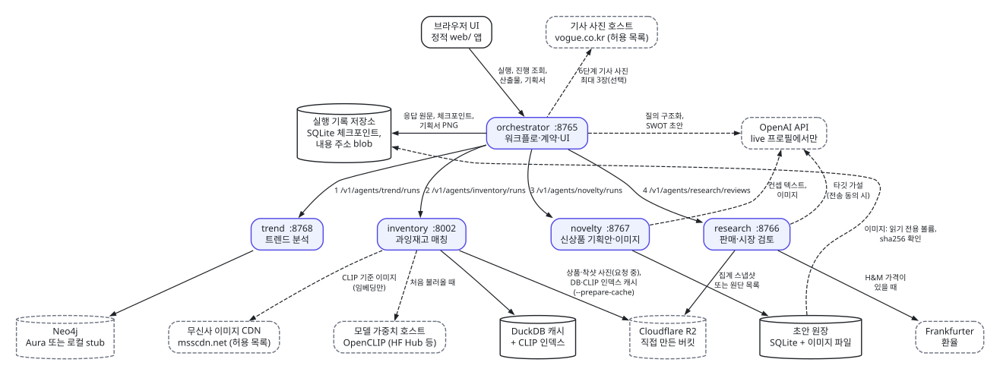
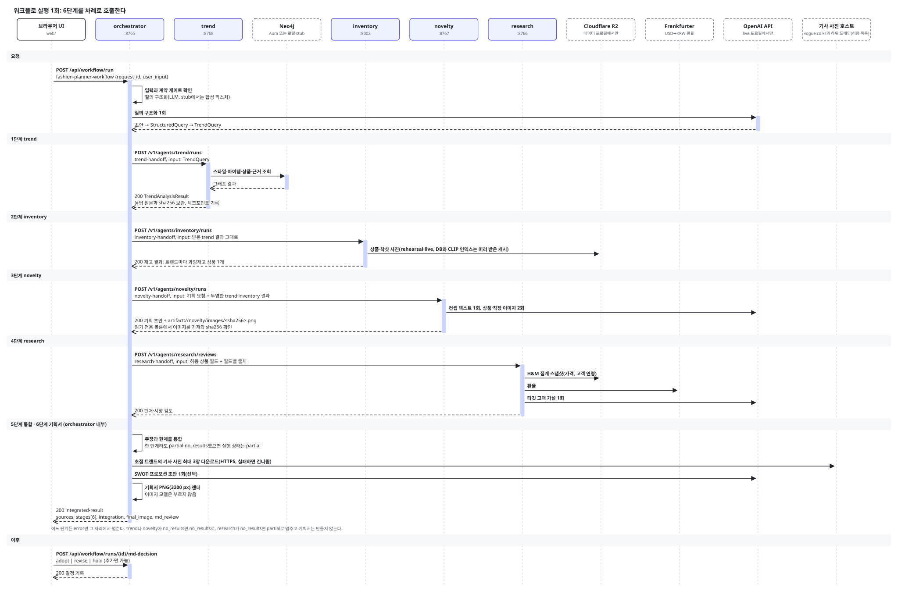

# 구조

orchestrator는 기획 요청 하나를 받아 다른 네 서비스를 정해진 순서로 부르고, 응답 원문을 검증해 보관한 뒤
통합 결과와 기획서 PNG를 만든다. 서비스끼리는 서로 부르지 않고, 모든 호출이 orchestrator를 거친다.

<picture>
  <source media="(prefers-color-scheme: dark)" srcset="diagrams/system-dark.svg">
  
</picture>

그림의 상자와 화살표마다 코드 근거가 [diagrams/CLAIMS.md](diagrams/CLAIMS.md)에 있다.

## 1. 실행 흐름

<picture>
  <source media="(prefers-color-scheme: dark)" srcset="diagrams/sequence-workflow-dark.svg">
  
</picture>

| 단계 | 하는 일 | 멈추는 조건 |
|---|---|---|
| 질의 구조화 | 자연어 기획 요청을 StructuredQuery로 바꾸고, 첫 품목·첫 시즌을 trend가 받는 TrendQuery로 만든다([query-structuring.md](query-structuring.md)) | 구조화 실패 |
| 1 trend | `POST /v1/agents/trend/runs`, 입력은 TrendQuery | `error`, `no_results` |
| 2 inventory | `POST /v1/agents/inventory/runs`, 입력은 받은 trend 결과를 바꾸지 않은 그대로 | `error` |
| 3 novelty | `POST /v1/agents/novelty/runs`, 입력은 기획 요청과 trend·inventory 결과의 투영(`novelty-input-projection`) | `error`, `no_results`(novelty는 200 응답에서 `ok`·`partial`만 내고, 실패는 HTTP 4xx·5xx로 온다) |
| 4 research | `POST /v1/agents/research/reviews`, 입력은 초안 `product_profile`의 허용 필드와 필드별 출처 | `error`, `no_results`(통합·기획서 없이 `partial`) |
| 5 통합 | 초안과 검토를 묶어 주장·근거·한계를 정리한다 | - |
| 6 기획서 | 실행 기록만으로 기획서 PNG(가로 3200 px)를 그린다. 이미지 모델은 부르지 않는다 | 실패해도 실행은 유지(`final_image.status`) |

- 한 단계라도 `partial`이거나 inventory가 `no_results`이면 실행 상태는 `partial`이다. `no_results`는 0이나 빈 성공으로
  바꾸지 않는다.
- 단계 순서와 이름은 `workflow_contract.py`의 `STAGES`, 멈춤 규칙은 `workflow.py`의 실행 루프에 있다.
- 서비스 응답의 `status`, 오류, 근거, `missing_data`, `limitations`는 원문 그대로 보관한다. 통합 결과는 이 값을 고쳐
  성공처럼 보이게 하지 않는다.

## 2. 저장과 재실행

실행 기록 저장소는 `ORCHESTRATOR_WORKFLOW_STORE_DIR`(기본 `.local/workflow`, 컨테이너 `/app/.local/workflow`) 아래에 있다.

- **blob**: 서비스 응답 원문, 호출 요청, 기획서 PNG 같은 바이트를 `blobs/<sha256>`에 내용 주소로 저장한다.
  참조는 `artifact://orchestrator/blobs/<sha256>`이고 크기와 SHA-256을 함께 적는다.
- **SQLite 체크포인트**(`checkpoints.sqlite3`): 단계마다 호출 전(`started`)과 결과(`done`)를 기록하고, 실행 결과
  (`initial`, `current`, 이미지 재시도별)와 MD 결정 기록을 둔다.
- **같은 `request_id`로 다시 요청하면** 저장된 결과를 돌려준다. 서비스를 다시 부르지 않는다.
- **호출은 시작했지만 결과가 없는 단계**(프로세스가 그 사이에 죽은 경우)는 다시 부르지 않고 `409 STAGE_OUTCOME_UNKNOWN`으로
  닫힌 쪽으로 실패한다. 유료 호출이 결과를 모른 채 두 번 나가지 않게 하기 위해서다.
- **6단계 재시도**(`POST /v1/orchestrations/image-retries`, `ORCHESTRATOR_WORKFLOW_IMAGE_RETRY_ENABLED=1`일 때만)는 저장된
  실행으로 기획서만 다시 그리고 앞 단계 서비스는 부르지 않는다. 재시도 키마다 결과가 따로 저장된다.
- **novelty 이미지**는 novelty가 자기 볼륨에 쓰고, orchestrator가 읽기 전용 마운트(`/peer/novelty`)에서 읽어 크기와
  SHA-256을 확인한 뒤 자기 blob으로 가져온다. 경로 탈출, 심볼릭 링크, 크기·해시 불일치는 거절한다.
- 해시 규칙(`python-json-sort`)과 artifact URI 규칙은 [contracts.md](contracts.md)에 있다.

## 3. 6단계 기획서

`planning_sheet.py`가 저장된 통합 결과만 읽어 상품 하나의 기획서 포스터를 그린다(Pillow, 결정적 배치).

- **세 열**: 분석(초점 트렌드의 색·소재·기사 사진, 그 트렌드에 매칭된 재고 상품), 디자인(novelty 콘셉트, 상품·착장 시안,
  상품 프로필), 마케팅(타깃, 판매·시장 값, 가격, 프로모션 아이디어, MD 검토 항목).
- **초점 트렌드**: novelty 초안의 `trend_basis.source_style_id`가 가리키는 스타일. 없으면 초안이 가장 많이 인용한 스타일.
  trend 결과의 트렌드 순서는 Style id 순이라 관련도를 뜻하지 않으므로 첫 번째 트렌드를 쓰지 않는다.
- **기사 사진**: 초점 트렌드의 예시 사진을 최대 3장 받는다. HTTPS만, 허용 목록(`ORCHESTRATOR_TREND_PHOTO_HOSTS`, 기본
  `vogue.co.kr`과 하위 도메인), 리다이렉트 2번까지, 장당 5 MiB·600만 화소 이하, 10초 타임아웃, 재시도 없음. 받지 못한
  사진은 건너뛰고 실행을 실패시키지 않는다. 받은 사진은 실행 기록에 저장되고, 기획서 다시 그리기는 네트워크를 쓰지 않는다.
  `ORCHESTRATOR_TREND_PHOTOS_ENABLED=0`이면 받지 않는다.
- **SWOT·프로모션 초안**(선택): LLM 설정이 있으면 실행 요약(사용자 원문과 이미지는 빼고)으로 1번 호출한다. 사분면마다
  0~4개, 프로모션 0~3개, 차별화 포인트 0~3개만 받고 형식에 맞지 않으면 버린다. 기획서에는 "LLM 가설 · MD 검토 필요"로
  표시한다. 실패해도 실행은 실패하지 않는다. `ORCHESTRATOR_SWOT_ENABLED=0`이면 부르지 않는다.
- **표시 원칙**: 서비스가 낸 값은 그대로 보여 주고, 없는 값은 비워 둔 채 이유를 적는다. 근거 ID를 만들어 내지 않는다.
  합성 데이터가 섞였으면 "합성·샘플 데이터 포함", novelty 합성 이미지면 "합성 이미지 — 생성된 컨셉 아님"을 붙인다.

## 4. 계약 게이트

`contracts/workflow/baseline.json`이 `frozen`이고, 스냅샷 해시와 스키마 파일이 일치하고, 동결 증거에 실패가 없을 때만
워크플로를 실행한다. 아니면 `409 CONTRACT_NOT_FROZEN`이다. 개발 중에는 `ORCHESTRATOR_WORKFLOW_ALLOW_PROPOSED=1`로
`proposed` 기준선에서도 실행할 수 있고, 그때 결과에 `workflow-contract not frozen; development run` 한계가 붙는다.
기준선은 `scripts/freeze_workflow_contract.py`로만 쓴다([contracts.md](contracts.md#7-기준선-동결)).

## 5. 네트워크 경계

**인바운드(orchestrator가 받는 요청).** 워크플로 경로는 다음 세 조건을 모두 만족할 때만 받는다.

- 상대가 loopback이거나 `ORCHESTRATOR_TRUSTED_PEER_CIDRS` 안의 주소다.
- `Host` 헤더가 `ORCHESTRATOR_ALLOWED_HOSTS` 안에 있다(기본 `127.0.0.1:<포트>`, `localhost:<포트>`).
- `Origin`이 없거나 정확히 `http://<Host>`다(포트 포함).

컨테이너 모드(`ORCHESTRATOR_RUNTIME=container`)에서는 `GET /api/health`와 정적 파일을 뺀 모든 경로에 이 검사를 적용한다.
기본 바인드는 `127.0.0.1`이고, 다른 주소에 바인드하려면 `ORCHESTRATOR_ALLOW_REMOTE_BIND=1`이 필요하다. 표준 라이브러리
`http.server`는 인터넷에 직접 노출하도록 만든 서버가 아니므로, 사설 네트워크나 로컬에서만 쓴다.

**아웃바운드(orchestrator가 보내는 요청).**

- 서비스 URL은 HTTPS(인증서 검증)여야 한다. 평문 HTTP는 두 경우만 허용한다: 개발 모드(`FASHION_PLANNER_HTTP_DEV_MODE=1`)의
  loopback, 또는 `ORCHESTRATOR_HTTP_PRIVATE_HOSTS`에 적은 한 단어 호스트 이름(컨테이너 네트워크의 `trend` 등)이면서 토큰이 있을 때.
- 모든 서비스 호출에 공용 bearer 토큰(`FASHION_PLANNER_SERVICE_TOKEN`)을 붙인다.
- 타임아웃: 연결 3초, 읽기 75초(`ORCHESTRATOR_WORKFLOW_CONNECT_TIMEOUT_SECONDS`, `ORCHESTRATOR_WORKFLOW_READ_TIMEOUT_SECONDS`).
  inventory와 novelty는 처리 시간이 길어 따로 정한다(`..._INVENTORY_READ_TIMEOUT_SECONDS`, `..._DRAFT_READ_TIMEOUT_SECONDS`).
  호출받는 쪽의 마감보다 길게 잡아야 상대가 보낸 시간 초과 응답을 받을 수 있다. novelty 읽기 타임아웃(Compose 600초)은
  novelty 기본 시간 제한의 최악 경우(텍스트와 이미지 두 장)보다 길게 잡았으므로, novelty의 시간 제한을 늘리면 함께 늘린다. 예를 들어 Compose에서 inventory 마감은
  180초(`INVENTORY_HANDOFF_TIMEOUT_SECONDS`), orchestrator의 inventory 읽기 타임아웃은 210초라서, inventory가 먼저
  `504 TIMEOUT`을 보내고 orchestrator는 이를 `504 UPSTREAM_TIMEOUT`으로 기록한다.
- 자동 재시도는 없다. 실패 매핑은 [contracts.md](contracts.md#6-오류)에 있다.
- 로그에는 호출마다 JSON 이벤트 하나(요청 ID, 단계, 상태, 걸린 시간, 보낸 바이트 수)만 남기고, 페이로드·응답 원문·프롬프트·
  비밀값은 남기지 않는다.

## 6. 웹 UI

`web/`의 정적 파일(빌드 단계 없는 ES 모듈)을 orchestrator가 그대로 제공한다. 질의를 입력하면 질의 구조화 결과를 보여 주고,
실행 진행(6단계)을 따라가며 단계별 결과, 근거와 원문 JSON, 기획서 PNG를 보여 준다. MD 결정(`adopt`, `revise`, `hold`)은
추가만 되는 기록으로 남는다.

- 응답 헤더에 CSP와 `X-Content-Type-Options: nosniff`를 붙인다. 이미지는 자기 출처와 trend 카드의 기사 사진 호스트
  (`img.vogue.co.kr`)만 허용한다.
- 화면 계산 규칙(값이 없으면 0이 아니라 "없음", 서비스 상태를 바꾸지 않음, 링크는 http(s)만)은 `web/js/model.js`에 모으고
  `node --test web/tests/model.test.mjs`로 검사한다.
- 글꼴(Jost, Bodoni Moda)은 SIL OFL 1.1이며 라이선스 파일이 `web/fonts/` 아래에 함께 있다. 배경 이미지는 이 레포의
  `tools/ui-assets/silk.py`로 만든 것이다.

## 7. 코드 지도

| 위치 | 역할 |
|---|---|
| `src/fashion_planner_orchestrator/server.py` | HTTP 진입점, 정적 UI, 인바운드 신뢰 검사, 질의 구조화 UI 경로 |
| `workflow_http.py` | 워크플로 HTTP 경로, 설정 읽기, 서비스 어댑터 구성, 기획서 응답 |
| `workflow.py` | 단계 실행 루프, 체크포인트, 재실행, 통합, 6단계 |
| `workflow_contract.py` | 스키마 검증과 결합 검사(요청·응답·투영·출처), 계약 게이트 |
| `workflow_store.py` | blob 저장, SQLite 체크포인트, artifact 읽기·가져오기 |
| `connectors.py` | 아웃바운드 URL 정책, 토큰, 타임아웃 |
| `upstream_projection.py` | novelty에 보내는 trend·inventory 결과 투영 |
| `planning_sheet.py`, `trend_photos.py`, `swot.py` | 6단계 기획서, 기사 사진, SWOT 초안 |
| `query/` | 질의 구조화(StructuredQuery, TrendQuery 변환) |
| `llm_provider.py` | 질의 구조화·SWOT의 LLM 호출(OpenAI 또는 Anthropic SDK, 호출할 때만 import) |
| `system_status.py` | `GET /api/system/status`: 서비스 연결 상태, 계약 상태, 설정 요약(비밀값 없음) |
| `web/` | 정적 UI |
| `deploy/` | Docker Compose 배포와 CLI([deploy/README.md](../deploy/README.md)) |
