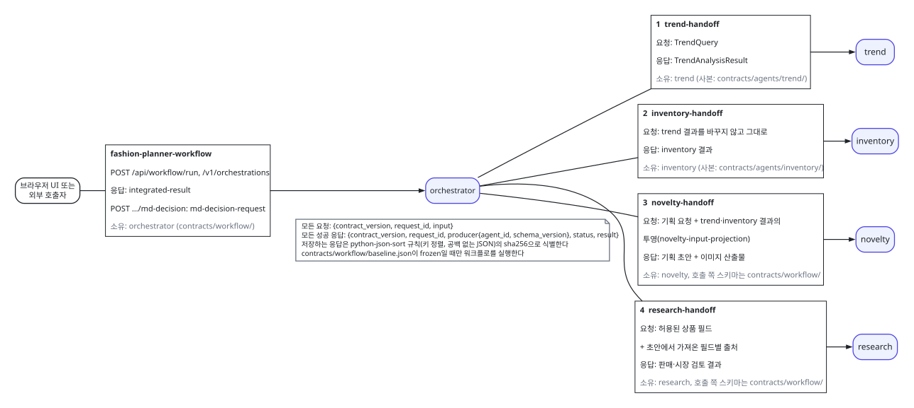

# 계약

다섯 서비스는 HTTP와 JSON 계약으로만 연결된다. 각 서비스가 자기 요청·응답 계약을 소유하고, orchestrator는
호출하는 쪽의 스키마(`contracts/workflow/`)와 각 서비스 계약의 사본(`contracts/agents/`)을 함께 둔다.

<picture>
  <source media="(prefers-color-scheme: dark)" srcset="diagrams/contracts-dark.svg">
  
</picture>

## 1. 이름과 버전

- 전송 이름(`contract_version`)에는 버전을 넣지 않는다. 경로마다 이름이 하나다.
- 페이로드 버전은 응답의 `producer.schema_version` 한 곳에만 둔다. 지금은 모두 `"1.0.0"`이다.
- 스키마 `$id`는 `https://contracts.fashion-planner.invalid/<소유 서비스>/<파일>`이다. `.invalid`는 실제로 접속하는
  주소가 아니라 식별자다.

| 경로 | `contract_version` | 요청 | 응답 | 소유 |
|---|---|---|---|---|
| `POST /api/workflow/run`, `POST /v1/orchestrations` | `fashion-planner-workflow` | `{request_id, user_input}` | integrated-result(`contracts/workflow/integrated-result.schema.json`) | orchestrator |
| `POST /api/workflow/runs/{id}/md-decision` | `fashion-planner-workflow` | MD 결정(`contracts/agents/orchestrator/input/md-decision-request.contract.json`) | 결정 기록 | orchestrator |
| `POST /v1/agents/trend/runs` | `trend-handoff` | TrendQuery | TrendAnalysisResult | trend |
| `POST /v1/agents/inventory/runs` | `inventory-handoff` | 받은 trend 결과 그대로 | inventory 결과 | inventory |
| `POST /v1/agents/novelty/runs` | `novelty-handoff` | 기획 요청 + trend·inventory 결과의 투영 | 기획 초안(+ 이미지 참조) | novelty(호출 쪽 스키마: `contracts/workflow/planning-draft-{request,response}.schema.json`) |
| `POST /v1/agents/research/reviews` | `research-handoff` | 허용 상품 필드 + 필드별 출처 | 판매·시장 검토 | research(호출 쪽 스키마: `contracts/workflow/research-review-{request,response,error}.schema.json`) |

## 2. 공통 형식

```text
요청: {"contract_version": "<이름>", "request_id": "<ID>", "input": {...}}
성공: {"contract_version", "request_id", "producer": {"agent_id", "schema_version"}, "status", "result": {...}}
실패: {"contract_version", "request_id" | null, "status": "error",
       "error": {"code", "message", "stage", "fatal", "retryable"}}
```

- `status`는 `ok`, `partial`, `no_results`, `error` 가운데 하나다. `partial`과 `no_results`는 HTTP 200이다.
  `no_results`는 "0개"나 빈 성공이 아니다.
- 모르는 `contract_version`은 모델·DB·네트워크 작업 전에 `422 UNSUPPORTED_CONTRACT_VERSION`으로 거절한다.
- 정의되지 않은 키는 받지 않는다(스키마의 `additionalProperties: false`).
- `request_id`는 한 실행의 모든 호출에서 같다. 형식은 `[A-Za-z0-9][A-Za-z0-9_.:-]{0,127}`이다.

## 3. 단계별 입력

- **trend**: TrendQuery. 질의 구조화가 만든 StructuredQuery 가운데 첫 품목과 첫 시즌만 보낸다. 나머지 품목과 시즌은
  StructuredQuery에 남고, 조용히 버리지 않고 경고(`items_not_forwarded`, `seasons_not_forwarded`)로 알린다
  ([query-structuring.md](query-structuring.md)).
- **inventory**: trend 결과(`result`)를 바꾸지 않고 그대로 보낸다.
- **novelty**: `planning_request`, `trend_result`, `inventory_product_result` 세 키. trend·inventory 결과는 원문이 아니라
  투영 `novelty-input-projection`(`src/fashion_planner_orchestrator/upstream_projection.py`)을 보낸다.
  - trend 쪽: 유사 상품(`trends[].items[].similar_products`)과 근거의 `url`·`title`을 뺀다.
  - inventory 쪽: 같은 `style_id`의 상품 사진은 처음 한 번만 보내고 뒤 항목은 `null`로 둔다.
  - 배열 길이, 순서, `null` 자리는 그대로다. 원문은 실행 기록에 남고, 결합 검사는 원문에서 투영을 다시 계산해
    보낸 값과 같은지 확인한다. novelty는 본문을 1,000,000바이트까지 받는다([troubleshooting.md](troubleshooting.md#t-http-01)).
- **research**: 초안 전체가 아니라 `product_profile`에서 뽑은 다섯 필드(`category`, `product_type`, `gender`, `season`,
  `material`)와 필드별 출처(`kind`, `source_ref` = `novelty.draft.product_profile.<필드>`, `evidence_ids`)를 보낸다.
  초안에 쓸 수 있는 값이 없으면 결정적인 자리값을 `kind: proposal`로 보낸다. research는 이 값을 확정 사실이 아닌
  제안으로 다룬다.
  - research는 문자열을 120자까지 받는다. novelty가 이 다섯 값을 120자 이하로 보장한다. `product_type`, `gender`,
    `material`이 길면 novelty가 규칙 값이나 제안값으로 바꾼다. `category`와 `season`은 novelty가 기획 요청의 값을 그대로
    쓰므로 대신할 값이 없어, 120자를 넘는 요청은 novelty가 `422 INVALID_INPUT`으로 거절하고 3단계가 502로 멈춘다.
    orchestrator는 research를 부르기 전에도 요청을 `research-review-request.schema.json`으로 검증해, 넘는 값이 있으면
    research를 부르지 않고 `CONTRACT_VIOLATION`으로 멈춘다.
  - research 응답은 초안 전체나 초안 응답 해시를 증명하지 않는다. 그래서 통합 결과도 research 검토를 초안 전체의
    검증으로 표현하지 않는다.

## 4. 해시: `python-json-sort`

저장하는 JSON 응답과 요청은 다음 값으로 식별한다.

```python
sha256(json.dumps(v, sort_keys=True, ensure_ascii=False, separators=(",", ":"), allow_nan=False).encode("utf-8"))
```

- 엄격하게 파싱한다. 중복 키, NaN·Infinity, 문자열이 아닌 키는 거절한다.
- 바이트 그대로 저장하는 산출물(이미지 등)은 바이트의 SHA-256을 쓴다.

| 값 | SHA-256 |
|---|---|
| `{}` | `44136fa355b3678a1146ad16f7e8649e94fb4fc21fe77e8310c060f61caaff8a` |
| `{"b":1,"a":"한"}` | `67f2fd255e411935d63adb1352ddb23efd6054c61d3131965ab2809e0c10d61f` |
| `{"request_id":"req-1","n":[1,2.5,null,true]}` | `3bd2f324eddc3ee90c8ddbafe3968bef3a7b1670f1e8750a83a66ad530315f0c` |

## 5. 산출물 참조

- 형식: `artifact://<네임스페이스>/<상대 경로>`(`^artifact://[A-Za-z0-9_./-]+$`). 빈 경로 조각, `.`, `..`은 쓰지 않는다.
- 참조에는 `size_bytes`와 `sha256`이 함께 있다. 읽는 쪽은 경로 탈출과 심볼릭 링크를 거절하고, 크기와 해시가 맞을 때만 쓴다.
- orchestrator는 `artifact://orchestrator/blobs/<sha256>`을 만든다. 같은 바이트는 늘 같은 참조다.
- novelty 이미지는 `artifact://novelty/images/<sha256>.<확장자>`이고, orchestrator는 읽기 전용 마운트에서 확인해 가져온다.
- research 응답에는 산출물 필드가 없다(있으면 계약 위반).

| 코드 | HTTP | 뜻 |
|---|---|---|
| `ARTIFACT_READER_REQUIRED` | 503 | 읽기 설정이 없음 |
| `INVALID_ARTIFACT_URI`, `INVALID_ARTIFACT_PATH` | 422 | 형식이 틀렸거나 경로가 밖으로 나감 |
| `ARTIFACT_UNAVAILABLE` | 503 | 바이트를 읽을 수 없음 |
| `ARTIFACT_SIZE_MISMATCH`, `ARTIFACT_HASH_MISMATCH` | 422 | 바이트가 참조와 다름 |

## 6. 오류

| HTTP | 뜻 |
|---|---|
| 400 | JSON이나 본문 형식 오류 |
| 401 | bearer 토큰이 없거나 틀림 |
| 403 | 신뢰하지 않는 출처나 상대 |
| 404, 405 | 없는 경로, 허용하지 않는 메서드 |
| 409 | 상태 충돌: 계약 미동결(`CONTRACT_NOT_FROZEN`), 결과를 모르는 단계(`STAGE_OUTCOME_UNKNOWN`) 등 |
| 413 | 너무 큼: 요청 8,388,608바이트, 보관하는 응답 16,777,216바이트 초과 |
| 415 | 미디어 타입 오류 |
| 422 | 계약 의미 위반, 지원하지 않는 버전 |
| 502 | 서비스 응답이 계약 위반이거나 2xx가 아님 |
| 503 | 의존 서비스 사용 불가(닫힌 쪽으로 실패) |
| 504 | 시간 초과 |

`retryable`은 503과 504에서만 참이다. 서비스 호출 실패는 다음처럼 바꾼다.

| 실패 | 결과 |
|---|---|
| 읽기 타임아웃 | 504 `UPSTREAM_TIMEOUT` |
| 연결 거부·끊김, 서비스가 보낸 503 | 503 `UPSTREAM_UNAVAILABLE` |
| 서비스가 보낸 504 | 504 `UPSTREAM_TIMEOUT` |
| 서비스의 401·403 | `UPSTREAM_AUTH` |
| 그 밖의 2xx가 아닌 응답 | 502 |
| 계약·파싱 실패 | 502 `CONTRACT_VIOLATION` |

결합 검사 실패 코드는 서비스 이름을 접두로 쓴다(예: `NOVELTY_CALL_ENVELOPE_INVALID`, `RESEARCH_PRODUCT_PROJECTION_MISMATCH`).
메시지에는 비밀값, 헤더, 서비스 응답 원문을 넣지 않는다. 거절한 응답 원문은 실행 기록에만 보관한다.

## 7. 기준선 동결

- `contracts/workflow/snapshot.json`: 계약 파일마다 SHA-256. 스키마 바이트를 고정한다.
- `contracts/workflow/baseline.json`: `proposed` 또는 `frozen`. `frozen`이면 동결 증거(참조 fixture, 변형 프로브, 함께 돌린
  테스트, 다섯 레포의 checkout 지문)가 함께 있다. 브랜치나 커밋은 적지 않는다(히스토리를 정리하면 바뀐다).
- 쓰기는 `scripts/freeze_workflow_contract.py`로만 한다.

```bash
python scripts/freeze_workflow_contract.py --check     # 기준선과 스냅샷이 맞는지
python scripts/freeze_workflow_contract.py --init      # 새 스냅샷으로 proposed 기준선
python scripts/freeze_workflow_contract.py --freeze \
  --suite "python -m unittest discover -s tests" --suite "node --test web/tests/model.test.mjs"
```

`--freeze`는 다섯 레포가 이 레포 옆(`../fashion-planner-*`)에 깨끗한 상태로 있어야 하고, 하나라도 실패하면 아무것도
쓰지 않는다.

## 8. 서비스 계약 사본

`contracts/agents/<서비스>/`에는 각 서비스가 공개한 계약의 사본이 있다. 출처와 갱신 방법은
[`contracts/agents/SOURCES.md`](../contracts/agents/SOURCES.md)에 표로 정리된다.

| 방식 | 뜻 |
|---|---|
| 복사 | 서비스 레포의 JSON Schema 파일을 감싸 저장 |
| pydantic 내보내기 | 서비스의 모델에서 `model_json_schema()`로 생성 |
| 고정(검사만) | 이 레포의 생성 코드가 의존하는 사본(trend의 TrendQuery). 따로 갱신 절차를 따른다 |
| 코드 읽고 작성 | 서비스가 JSON Schema를 내지 않아 코드를 읽고 이 레포에서 작성(novelty 입력, MD 결정 요청). 근거 파일의 해시가 바뀌면 다시 읽고 손으로 고친다 |

```bash
# 다섯 레포를 나란히 둔 상태에서
python scripts/export_agent_contracts.py            # 복사·pydantic 사본을 다시 쓴다
python scripts/export_agent_contracts.py --check    # 사본, SOURCES.md, 경로별 contract_version 비교
```

형제 레포가 없으면 그 서비스 항목은 건너뛴다. 레포 위치는 `FASHION_PLANNER_<SVC>_ROOT`(`TREND`, `INVENTORY`, `NOVELTY`,
`RESEARCH`), trend 모델을 내보낼 Python은 `FASHION_PLANNER_TREND_PYTHON`으로 바꿀 수 있다.

서비스 사이의 계약(요청·응답 형식)을 바꾸는 변경은 그 서비스 레포와 이 레포의 사본·호출 쪽 스키마를 함께 고친다.
호출 쪽 스키마를 바꾸면 스냅샷과 기준선을 다시 만든다.
